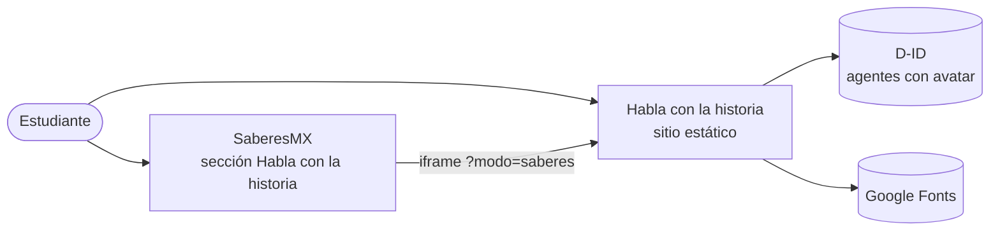
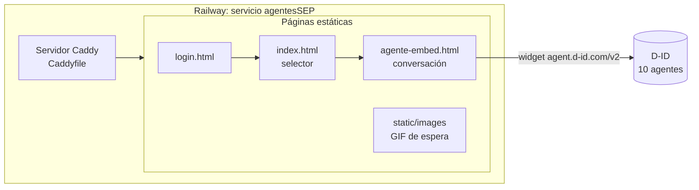
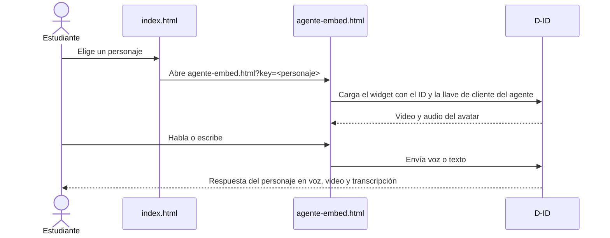

# Blueprint: Habla con la historia

## 1. Contexto (C4, nivel 1)

## 2. Contenedores (C4, nivel 2)

Caddy redirige `/saberes`, `/saberes/` y `/saberes.html` a `/` con un 302, porque la maqueta de SaberesMX que se publicaba en esas rutas se retiró.

## 3. Flujo principal

En SaberesMX, la página del sitio carga `agente-embed.html?key=<personaje>&modo=saberes` dentro de un iframe. En ese modo no se pide código de acceso, se oculta el botón «Volver» y se usa la paleta de SaberesMX.

## 4. Dependencias externas

| Servicio | Uso | Cuenta titular | Plan | Ubicación de la credencial |
| --- | --- | --- | --- | --- |
| D-ID | Diez agentes conversacionales con avatar, sus instrucciones y bases de conocimiento; widget `agent.d-id.com/v2/index.js` | Cuenta exclusiva del proyecto, separada de la de otros proyectos del área. PENDIENTE: titular | PENDIENTE | Gestor de contraseñas del área, grupo habla-con-la-historia |
| Railway | Hosting del sitio; despliegue automático desde `main` | PENDIENTE | PENDIENTE | Gestor de contraseñas del área, grupo habla-con-la-historia |
| SaberesMX | Sitio donde vivirán los personajes | PENDIENTE: ¿quién mantiene SaberesMX? | No aplica | No aplica |
| Google Fonts | Tipografías | No aplica | Gratuito | No aplica |

Los ID de agente y las llaves de cliente de D-ID están en el objeto `AGENTES` de `agente-embed.html`. D-ID diseña esas llaves para usarse en el navegador; su uso se limita por los dominios permitidos de cada agente. PENDIENTE: dominios permitidos configurados en D-ID.

## 5. Entornos

| Entorno | Dirección | Despliegue |
| --- | --- | --- |
| Producción | https://agentessep-production.up.railway.app | Automático en Railway con cada push a `main` |
| Sitio de pruebas de SaberesMX | PENDIENTE: dirección de la sección Habla con la historia | Lo despliega quien mantiene SaberesMX |
| Prototipos de interfaz (antecedentes) | https://agentes-historicos-v6a.netlify.app, https://agentes-historicos-v6b.netlify.app, https://agentes-historicos-v8.netlify.app | Netlify, fuera de este repositorio; ver [0004](decisiones/0004-se-adopta-la-interfaz-v8-con-cuatro-grupos-de-personajes.md) |

## 6. Datos

- El sitio no tiene base de datos ni guarda información de las personas usuarias. En el navegador solo se guarda la marca de sesión `ag_auth` en `sessionStorage`.
- La voz, el texto y las transcripciones de cada conversación se procesan en D-ID. PENDIENTE: retención de conversaciones en D-ID.
- Personas usuarias previstas: estudiantes. Por ahora solo hay pruebas.
- Los contenidos de los personajes provienen de biografías y guías didácticas entregadas por el cliente; se resguardan en la carpeta de Drive del proyecto, fuera del repositorio.
- Acuerdo aplicable de tratamiento de datos: PENDIENTE.

## 7. Riesgos y deuda técnica

Los riesgos se registran en el registro RAID de la bitácora ejecutiva (acceso interno).
